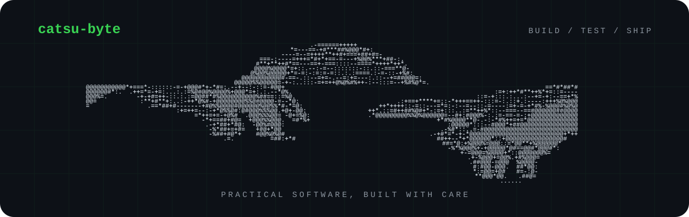

<div align="center">
  
</div>

## Hallo, ich bin catsu-byte

Ich lerne Softwareentwicklung, indem ich Dinge baue, ausprobiere und Schritt für Schritt verbessere.

```text
build  →  test  →  learn  →  repeat
```

### Was hier entsteht

- kleine Projekte und Experimente
- nachvollziehbare Fortschritte statt perfekter Fassaden
- Code, den ich beim Lernen wirklich selbst verstehe

### Aktivität

Die grünen Felder unter diesem Profil zeigen meine echten Beiträge auf GitHub. Jeder Arbeitstag beginnt mit einer sinnvollen Änderung — nicht mit einem leeren Commit.

<div align="center">
  <sub>Profil im Aufbau · seit 2026</sub>
</div>
